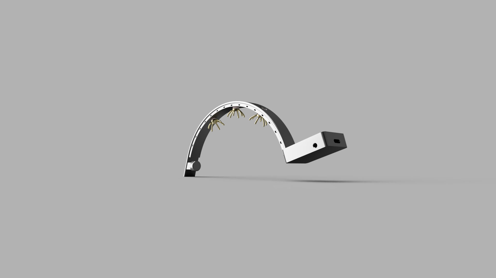
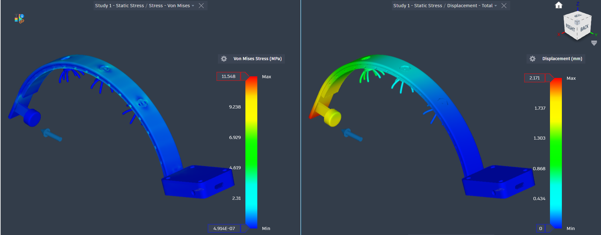

# Sagittal 3-Channel Dry-Contact EEG Headband Chassis

An ergonomically compliant, trans-hair dry-contact EEG headband chassis designed from first principles in **Autodesk Fusion**. The assembly features an integrated thermal-management lattice, compliance-tuned sagittal curvature, internal high-impedance lead-routing conduits, and an occipital enclosure with DIN 42802-1 touch-proof reference interfaces.

---

## 📌 Visual Highlights

| Hero Photorealistic Render | Mechanical FEA Study (Stress & Compliance) |
| :---: | :---: |
|  |  |

---

## 🧠 Engineering Rationale & Biomechanical Architecture

### 1. Scalp Microclimate & Thermal Management (Perforated Arch)
* **Physiological Challenge:** The human scalp possesses high eccrine sweat gland density. Continuous solid plastic bands trap heat and perspiration, causing ionic **sweat bridges** between adjacent channels that induce low-frequency baseline drift ($0.05\text{--}1\text{ Hz}$).
* **Mechanical Solution:** An array of through-apertures spans the lateral arch walls. These perforations provide passive convection cooling, relieve non-structural mass along the neutral bending axis to minimize rotational inertia ($I = m \cdot r^2$), and double as external strain-relief tie anchors.

### 2. Contact Mechanics & Trans-Hair Geometry
* Standard wet electrodes rely on conductive electrolytic gel. To eliminate consumables, this design utilizes multipronged "spider" contact hubs designed for physical hair parting and direct scalp stratum corneum contact.
* Sized along an overall sagittal chord length of **$205.49\text{ mm}$** and a vertical rise of **$60.46\text{ mm}$**, active hubs strictly align with the **International 10–20 System**:
  * **CH1 ($F_z$):** Frontal executive rhythm / Theta dynamics.
  * **CH2 ($C_z$):** Vertex sensorimotor rhythm / Mu suppression.
  * **CH3 ($P_z$):** Parietal somatosensory / P300 evoked potential paradigm.

### 3. Anti-Pitch Mechanical Constraint
A single curved arch over a convex skull is inherently unstable along the pitch axis. An anterior cantilever pad (**$F_{pz}$**, $\varnothing 10.0\text{ mm}$) rests directly against the hairless supraorbital frontal plane, creating a stable 3-point kinematic constraint that arrests sagittal rocking during head movement.

### 4. Occipital Packaging & Reference Interfacing
* The posterior housing is canted downward to keep the center of mass close to the cranial base, sized to package an ADS1299-class biopotential AFE, BLE transceiver SoC, and a compact rechargeable LiPo cell.
* **DIN 42802-1 Compliance:** Includes bilateral $\varnothing 3.2\text{ mm}$ bores designed for panel-mount insulated sockets receiving standard $\varnothing 1.5\text{ mm}$ safety touch-proof ear/mastoid reference leads ($M_1/M_2$).

---

## 🔬 Finite Element Analysis (FEA) Simulation

Linear static stress and compliance simulation was conducted within the Autodesk Fusion Simulation Workspace to determine structural yield margins and elastic deflection under cranial apposition.

* **Material Model:** Selective Laser Sintering (SLS) Polyamide 12 (**PA12 Nylon**)
  * *Isotropic Estimate Yield Strength:* $48.0\text{ MPa}$
  * *Biocompatibility:* ISO 10993 certified for prolonged intact skin contact.
* **Boundary Conditions:**
  * Fixed constraint applied at the anterior $F_{pz}$ forehead contact interface.
  * Normal Apposition Preload: **$1.2\text{ N}$** applied vertically along the sagittal curvature (~$0.4\text{ N}$ distributed per electrode site to pierce hair without exceeding capillary perfusion pressure of ~$32\text{ mm Hg}$).

### Simulation Results
* **Max von Mises Stress:** $\mathbf{11.55\text{ MPa}}$ (Safety Factor = $\mathbf{4.16}$)
* **Max Resultant Displacement:** $\mathbf{2.171\text{ mm}$
* **Derived Structural Stiffness:**
  $$k = \frac{F}{\delta} = \frac{1.2\text{ N}}{2.171\text{ mm}} \approx \mathbf{0.553\text{ N/mm}}$$
* *Conclusion:* Demonstrates compliant flexural behavior that accommodates cranial anatomical variance without plastic deformation or localized ischemia.

---

## 📐 Manufacturing Documentation

The project includes an ISO-standard manufacturing drawing ([EEG_Chassis Drawing.pdf](EEG_Chassis%20Drawing.pdf)):
* **Drawing Number:** `BME-BCI-001`, Rev A
* **General Tolerances:** ISO 2768-m
* **Intended Process:** SLS (Selective Laser Sintering) Additive Manufacturing (supports internal wire conduits without sacrificial support removal).

---

## 📂 Design Files in this Repository

* **3D CAD Neutral Exchange:** [`EEG_headband_chassis.step`](EEG_headband_chassis.step)
* **3D Mesh (Interactive Viewable):** [`EEG_headband_chassis.stl`](EEG_headband_chassis.stl)
* **2D Production Drawing Sheet:** [`EEG_Chassis Drawing.pdf`](EEG_Chassis%20Drawing.pdf)

---

## 👤 Author
**Prerna Salya**  
*Biomedical Engineering Undergraduate*  
*Focus:* Neural Engineering, Biopotential Instrumentation, & Biomechanics
